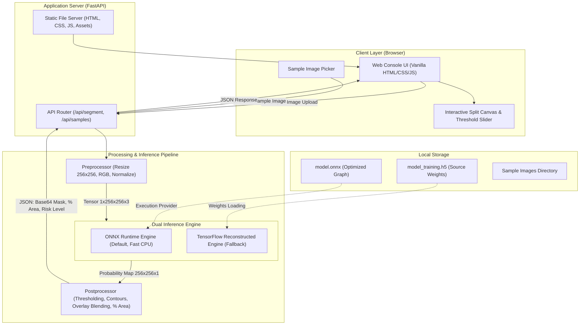

# System Design & Architecture Document (SDD)
## Flood Detection Area Segmentation System (FloodDetec AI)

- **Document Version**: 1.0.0
- **Status**: Approved
- **Backend Stack**: Python 3.12, FastAPI, Uvicorn, NumPy, OpenCV, ONNX Runtime / TensorFlow
- **Frontend Stack**: Vanilla HTML5, Modern CSS (Custom Design System), Vanilla ES6 JavaScript
- **Model Format**: Keras HDF5 (`model_training.h5`, 122.6 MB) & ONNX Export (`model.onnx`, 122 MB)

---

## 1. Arsitektur Tingkat Tinggi (High-Level Architecture)

Sistem dirancang dengan arsitektur client-server monolitik ringan (lightweight decoupled monolith). Backend FastAPI bertindak sebagai penyedia REST API untuk inferensi machine learning dan sekaligus menyajikan berkas frontend statis secara lokal.



---

## 2. Dekomposisi Komponen Sistem

### 2.1 Presentation Layer (Frontend SPA)
- **Komponen Utama**:
  1. `Header & Status Bar`: Menampilkan identitas sistem, status kesiapan mesin inferensi (ready/busy), dan toggle tema (Dark/Light).
  2. `Dropzone & File Selector`: Penanganan input citra melalui drag-and-drop atau dialog file lokal dengan pratinjau instan.
  3. `Quick Sample Gallery`: Komponen kartu pratinjau thumbnail citra banjir bawaan yang dapat diklik untuk uji coba langsung.
  4. `Interactive Comparison View`:
     - Tampilan Split-Slider: Membandingkan citra asli dan citra overlay secara horizontal menggunakan kursor mouse atau tombol panah keyboard.
     - Tampilan Tab Berganti: Citra Asli, Mask Biner (Hitam-Putih), dan Citra Overlay Berwarna.
  5. `Analytical Control Panel`:
     - Threshold Range Slider: Mengatur ambang batas binerisasi (0.10 s.d. 0.90) yang dapat memicu rekalkulasi metrik secara real-time.
     - Severity Risk Card: Kartu status visual dengan badge warna (Aman/Waspada/Siaga/Awas), persentase luas banjir, dan estimasi piksel tergenang.
     - Tombol Ekspor: Mengunduh citra hasil segmentasi beserta metadata analisis.

### 2.2 Application & API Layer (FastAPI Backend)
- **Endpoints**:
  - `GET /`: Menyajikan berkas utama `index.html`.
  - `GET /api/health`: Memeriksa status kesiapan model dan spesifikasi engine yang aktif (ONNX / TensorFlow).
  - `GET /api/samples`: Mengembalikan daftar citra sampel bawaan beserta URL pratinjaunya.
  - `POST /api/segment`: Menerima berkas citra multipart, mengeksekusi inferensi, dan mengembalikan hasil segmentasi, metrik luas, dan klasifikasi risiko.
  - `POST /api/recalculate`: Menerima probability map atau ID sesi dengan threshold baru untuk memperbarui persentase tanpa mengulang inferensi neural network.

### 2.3 Processing & Inference Layer
- Terdiri atas modul Python murni:
  - `preprocessor.py`: Menangani decoding citra (OpenCV), konversi ruang warna BGR ke RGB, resizing bilinear ke 256x256, dan normalisasi rentang `[0.0, 1.0]`.
  - `model_builder.py`: Definisi arsitektur Attention U-Net murni menggunakan layer fungsional standar untuk merekonstruksi model dari `model_training.h5`.
  - `onnx_exporter.py`: Skrip utilitas satu kali untuk mengonversi graf komputasi ke format standar ONNX.
  - `inference_engine.py`: Wrapper abstrak yang memprioritaskan ONNX Runtime (jika berkas `.onnx` tersedia) dan secara otomatis beralih ke rekonstruksi TensorFlow jika belum dikonversi.
  - `postprocessor.py`: Melakukan thresholding biner, ekstraksi kontur polygon air, pewarnaan overlay Cyan (`#00F0FF` dengan alpha blending 40%), serta kalkulasi metrik luasan.

---

## 3. Spesifikasi Arsitektur Model: Attention U-Net

Arsitektur model direkonstruksi secara presisi berdasarkan analisis bobot dan konfigurasi layer dari `model_training.h5`:

### 3.1 Struktur Layer dan Dimensi Tensor

```
Input Image (256, 256, 3)
   │
   ├──> [Encoder 1]: 2x Conv2D(32, 3x3) + Dropout(0.1) ─────────── (256, 256, 32) ───┐
   │         │ MaxPooling2D(2x2)                                                       │
   │         ▼                                                                         │
   ├──> [Encoder 2]: 2x Conv2D(64, 3x3) + Dropout(0.1) ─────────── (128, 128, 64) ──┐  │
   │         │ MaxPooling2D(2x2)                                                      │  │
   │         ▼                                                                        │  │
   ├──> [Encoder 3]: 2x Conv2D(128, 3x3) + Dropout(0.2) ────────── (64, 64, 128) ──┐  │  │
   │         │ MaxPooling2D(2x2)                                                     │  │  │
   │         ▼                                                                       │  │  │
   ├──> [Encoder 4]: 2x Conv2D(256, 3x3) + Dropout(0.2) ────────── (32, 32, 256) ─┐ │  │  │
   │         │ MaxPooling2D(2x2)                                                    │ │  │  │
   │         ▼                                                                      │ │  │  │
   └──> [Encoding (Bottleneck)]: 2x Conv2D(512, 3x3) + Dropout(0.3) ─ (16, 16, 512) │ │  │  │
             │                                                                      │ │  │  │
             │ UpSampling2D(2x2) -> (32, 32, 512)                                   │ │  │  │
             ▼                                                                      │ │  │  │
        [Attention 1] <─────────────────────────────────────────────────────────────┘ │  │  │
             │ Gating: (32, 32, 512), Skip: (32, 32, 256) -> Attended: (32, 32, 256)  │  │  │
             ▼                                                                        │  │  │
        [Decoder 1]: Concat(512 + 256 = 768) + 2x Conv2D(256, 3x3) -> (32, 32, 256)  │  │  │
             │                                                                        │  │  │
             │ UpSampling2D(2x2) -> (64, 64, 256)                                     │  │  │
             ▼                                                                        │  │  │
        [Attention 2] <───────────────────────────────────────────────────────────────┘  │  │
             │ Gating: (64, 64, 256), Skip: (64, 64, 128) -> Attended: (64, 64, 128)   │  │
             ▼                                                                          │  │
        [Decoder 2]: Concat(256 + 128 = 384) + 2x Conv2D(128, 3x3) -> (64, 64, 128)   │  │
             │                                                                          │  │
             │ UpSampling2D(2x2) -> (128, 128, 128)                                     │  │
             ▼                                                                          │  │
        [Attention 3] <─────────────────────────────────────────────────────────────────┘  │
             │ Gating: (128, 128, 128), Skip: (128, 128, 64) -> Attended: (128, 128, 64)  │
             ▼                                                                              │
        [Decoder 3]: Concat(128 + 64 = 192) + 2x Conv2D(64, 3x3) -> (128, 128, 64)        │
             │                                                                              │
             │ UpSampling2D(2x2) -> (256, 256, 64)                                         │
             ▼                                                                              │
        [Attention 4] <─────────────────────────────────────────────────────────────────────┘
             │ Gating: (256, 256, 64), Skip: (256, 256, 32) -> Attended: (256, 256, 32)
             ▼
        [Decoder 4]: Concat(64 + 32 = 96) + 2x Conv2D(32, 3x3) -> (256, 256, 32)
             │
             ▼
        [Output Head]: Conv2D(1, 1x1, activation='sigmoid') -> (256, 256, 1)
```

### 3.2 Formulasi Matematika Attention Gate
Attention Gate berfungsi untuk memfilter fitur pada skip connection ($x$) menggunakan sinyal kendali (gating signal $g$) yang berasal dari lapisan yang lebih dalam. Hal ini memusatkan perhatian model pada area genangan air dan meredam noise pada latar belakang daratan.

1. **Transformasi Linier**:
   $$\theta_x = W_x * x \quad (\text{dimensi kanal } F_{int})$$
   $$\phi_g = W_g * g \quad (\text{dimensi kanal } F_{int})$$
2. **Aktivasi dan Normalisasi**:
   $$f = \text{ReLU}(\theta_x + \phi_g)$$
   $$f_{bn} = \text{BatchNorm}(f)$$
3. **Koefisien Perhatian (Attention Coefficient)**:
   $$\psi = \sigma(W_\psi * f_{bn}) \quad (\text{dimensi kanal 1, rentang } [0, 1])$$
4. **Attended Output**:
   $$\hat{x} = x \odot \psi$$

---

## 4. Pipeline Data dan Inferensi

### 4.1 Alur Pra-Pemrosesan (Preprocessing)
1. Citra masukan didekodekan dari byte buffer menggunakan OpenCV (`cv2.imdecode`).
2. Ruang warna dikonversi dari BGR standar ke RGB (`cv2.cvtColor`).
3. Dimensi asli citra $(H_{orig}, W_{orig})$ dicatat untuk pemetaan balik resolusi visual.
4. Citra di-resize ke $(256, 256)$ menggunakan interpolasi bilinear (`cv2.INTER_LINEAR`).
5. Piksel dinormalisasi ke rentang floating-point $[0.0, 1.0]$ melalui pembagian `255.0`.
6. Batch dimension ditambahkan: tensor akhir berbentuk `(1, 256, 256, 3)` dengan tipe data `float32`.

### 4.2 Alur Pasca-Pemrosesan (Postprocessing)
1. Output model berdimensi `(1, 256, 256, 1)` dipangkas menjadi matriks probabilitas 2D $P \in [0.0, 1.0]^{256 \times 256}$.
2. Binerisasi dilakukan berdasarkan threshold $T$ (default $T = 0.5$):
   $$M_{binary}(i, j) = \begin{cases} 1 & \text{jika } P(i, j) \ge T \\ 0 & \text{lainnya} \end{cases}$$
3. Luas tutupan banjir dihitung:
   $$\text{Flood Area Ratio} = \frac{\sum_{i,j} M_{binary}(i, j)}{256 \times 256} \times 100\%$$
4. Kontur genangan air diekstraksi menggunakan `cv2.findContours` untuk menghasilkan garis batas tepi.
5. Pembuatan Citra Overlay:
   - Warna masker diatur ke Electric Cyan: $C_{mask} = (0, 240, 255)$ dalam format RGB.
   - Blending dilakukan dengan bobot $\alpha = 0.40$:
     $$I_{blend} = I_{orig} \cdot (1 - \alpha \cdot M_{binary}) + C_{mask} \cdot (\alpha \cdot M_{binary})$$
   - Garis kontur digambar dengan ketebalan 1 piksel tanpa transparansi untuk kejelasan visual.
6. Hasil citra dienkodekan kembali ke format PNG dan dikonversi ke string Base64 Data URL agar dapat langsung ditampilkan pada elemen `` atau `<canvas>` di browser.

---

## 5. Spesifikasi REST API

### 5.1 Endpoint: Inferensi Segmentasi (`POST /api/segment`)
- **Content-Type**: `multipart/form-data`
- **Request Body**:
  - `file`: Berkas biner citra (JPG, JPEG, PNG, maks 10 MB).
  - `threshold`: Float opsional (default: `0.5`, rentang `0.1` - `0.9`).
- **Response Format**: `application/json`
```json
{
  "status": "success",
  "data": {
    "flood_percentage": 28.45,
    "flood_pixel_count": 18645,
    "total_pixel_count": 65536,
    "risk_level": "Siaga (Medium Risk)",
    "risk_color": "#F59E0B",
    "threshold_used": 0.5,
    "inference_time_ms": 185.4,
    "images": {
      "original_url": "data:image/png;base64,...",
      "binary_mask_url": "data:image/png;base64,...",
      "overlay_url": "data:image/png;base64,..."
    }
  }
}
```

### 5.2 Endpoint: Galeri Citra Sampel (`GET /api/samples`)
- **Response Format**: `application/json`
```json
{
  "samples": [
    {
      "id": "sample_01",
      "title": "Banjir Pemukiman Sub-Urban",
      "thumbnail_url": "/static/samples/sample_01.jpg",
      "expected_risk": "Siaga (Medium Risk)"
    },
    {
      "id": "sample_02",
      "title": "Kawasan Pertanian Tergenang",
      "thumbnail_url": "/static/samples/sample_02.jpg",
      "expected_risk": "Waspada (Low Risk)"
    }
  ]
}
```

### 5.3 Endpoint: Pemeriksaan Kesehatan Sistem (`GET /api/health`)
- **Response Format**: `application/json`
```json
{
  "status": "healthy",
  "engine": "ONNXRuntime",
  "device": "CPU",
  "model_loaded": true,
  "input_shape": [1, 256, 256, 3],
  "output_shape": [1, 256, 256, 1]
}
```

---

## 6. Penanganan Error dan Kondisi Tepi (Edge Cases)

| Skenario | Respons Sistem | Kode Status HTTP |
| :--- | :--- | :--- |
| File non-gambar diunggah (misal `.pdf` atau `.exe`) | Mengembalikan pesan validasi "Tipe file tidak didukung. Harap unggah format JPG atau PNG." | `415 Unsupported Media Type` |
| Ukuran file melebihi 10 MB | Mengembalikan pesan batas muatan "Ukuran berkas melebihi batas 10 MB." | `413 Payload Too Large` |
| Citra berdimensi sangat kecil (< 32x32) atau rasio aspek ekstrem (1:20) | Sistem melakukan padding proporsional ke aspek rasio 1:1 sebelum resizing, mencegah distorsi geometris. | `200 OK` (dengan indikasi warning) |
| Citra seragam tanpa variasi (misal gambar serba hitam/putih) | Model mengembalikan estimasi persentase 0.0% dengan status Aman. | `200 OK` |
| Model ONNX atau H5 belum dimuat di memori | Mengembalikan status layanan belum siap beserta panduan eksekusi konversi. | `503 Service Unavailable` |
